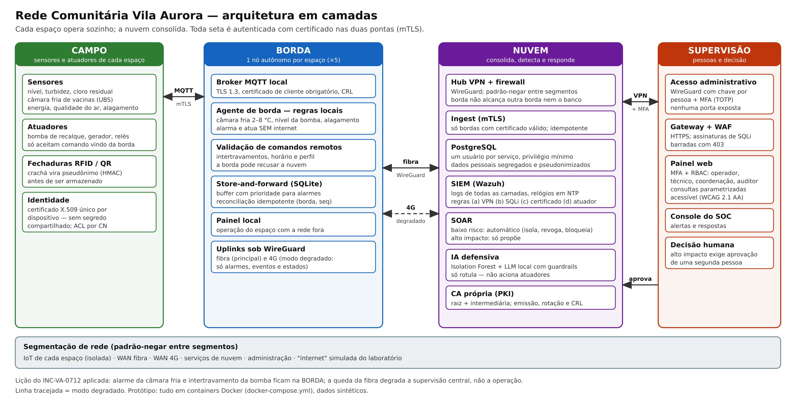

# E1 — Documento de Arquitetura

Rede Comunitária Vila Aurora · Infraestrutura segura, resiliente e modular.

## 1. Visão geral

A arquitetura é organizada em quatro camadas, da mais próxima do equipamento à supervisão humana.
A decisão central é que **cada espaço comunitário opera por conta própria** e a nuvem é um
consolidador — não um ponto único de falha. Foi essa dependência da nuvem que, no INC-VA-0712,
deixou a câmara fria de vacinas sem alarme quando a fibra caiu.

*Figura 1 — Arquitetura em camadas. Campo fala com a borda por MQTT com mTLS; a borda fala com a nuvem
por WireGuard sobre fibra ou 4G; a supervisão chega à nuvem apenas por VPN com MFA. Fonte editável:
`docs/img/arquitetura.svg`.*

Cada seta é autenticada com certificado em ambas as pontas (mTLS); nenhuma porta administrativa
fica exposta à internet.

## 2. Camadas

**Campo.** Sensores e atuadores de cada espaço (nível, turbidez, cloro, temperatura da câmara fria,
energia, alagamento, fechaduras RFID/QR, bomba, gerador). Cada dispositivo tem **certificado X.509
próprio** e publica apenas os próprios tópicos MQTT (ACL por identidade). No protótipo são
simuladores em container com modelo físico; o enunciado aceita simulação, e hardware real (ESP32/
Raspberry Pi) é diferencial opcional.

**Borda.** Um nó por espaço com: broker MQTT local (TLS 1.3, certificado de cliente obrigatório),
motor de **regras locais** (câmara fria 2–8 °C, intertravamento de nível da bomba, alagamento,
gerador), **store-and-forward** em SQLite e dois uplinks (fibra e 4G) sob túnel WireGuard. A borda
continua operando e alarmando **sem internet** e valida localmente qualquer comando remoto.

**Nuvem.** Ingestão autenticada por mTLS com reconciliação idempotente; PostgreSQL com usuários de
privilégio mínimo por serviço; SIEM (Wazuh) com coleta centralizada e NTP; SOAR com respostas de
baixo risco automáticas e aprovação humana para alto impacto; IA defensiva (detecção de anomalias e
triagem de e-mails). No protótipo roda em containers; em produção seria uma VM/servidor do laboratório.

**Supervisão.** Painel web acessível **apenas pela VPN administrativa com MFA**, atrás de um gateway
HTTPS com WAF mínimo (assinaturas de SQL Injection), com RBAC (operador,
técnico, coordenação, auditor), console do SOC e painel local em cada borda para operação offline.

## 3. Fluxos de dados principais

1. **Telemetria:** dispositivo → (mTLS) broker local → borda (aplica regras, bufferiza) → (WireGuard
   + mTLS) ingest → PostgreSQL → painel. Em queda de link, para no buffer e reconcilia depois.
2. **Comando de atuador:** painel (MFA/RBAC; aprovação de 2 pessoas se alto impacto) → ingest →
   borda (revalida: intertravamentos, horário, perfil) → dispositivo. A borda pode recusar.
3. **Alarme:** regra local na borda → alarme local + prioridade no buffer → painel/SIEM. Independe
   da nuvem.
4. **Detecção/resposta:** logs de todas as camadas → SIEM → alerta → SOAR → resposta (baixo risco
   automática; alto impacto aguarda aprovação).

## 4. Segmentação de rede

Redes isoladas (segmentos) com política padrão-negar entre elas: IoT por espaço, uplinks WAN
(fibra/4G), serviços de nuvem, administração e "internet" simulada. As bordas só alcançam a nuvem
por WireGuard e nunca umas às outras; o acesso administrativo ao painel/SIEM exige túnel **e** MFA.

## 5. Decisões e trade-offs

| Decisão | Por quê | Trade-off assumido |
|---|---|---|
| Operação autônoma na borda | Lição direta do incidente (câmara fria sem alarme) | Mais lógica distribuída para manter |
| WireGuard em vez de VPN legada | Chave por dispositivo/pessoa, credencial não-phishável | Gestão de chaves/PKI própria |
| CA própria + mTLS em tudo | Identidade forte, revogação, sem segredo compartilhado | Complexidade de PKI (rotação, CRL) |
| Painel parametrizado + versão legada só em lab | Demonstrar antes/depois do SQLi com segurança | Manter duas variantes no código |
| WAF por assinaturas no nginx, e não ModSecurity/CRS | Camada adicional simples de manter por voluntários; a correção real é a parametrização | Cobertura limitada e contornável por ofuscação |
| SOAR com aprovação humana p/ alto impacto | Evitar que automação desligue bomba numa enchente | Resposta um pouco mais lenta nesses casos |
| IA complementar, nunca atuando | LLM/anomalia não podem acionar físico (RT-17) | IA não substitui as regras determinísticas |
| Tudo em containers | Reprodutível, barato, atende ao enunciado | Memória forense limitada vs. VM |

## 6. Plano de redundância proporcional (RT-03)

O escopo é uma rede comunitária de orçamento limitado, então a redundância é **proporcional**, não
total:

- **Conectividade:** uplink principal por fibra e alternativo por 4G. No 4G (modo degradado) só
  sobem alarmes e agregados, por causa do custo/banda. Documentado e testado (teste de caos).
- **Operação:** cada borda é autônoma; a indisponibilidade da nuvem degrada a supervisão central,
  não a operação local.
- **O que *não* tem redundância, e por quê:** não há nuvem multi-região nem cluster de banco — o
  essencial roda na borda e o custo não se justifica para o escopo. Backup diário do banco cobre a
  perda de histórico. Um único modem 4G por espaço é aceito como risco (ver custos e manutenção).

## 7. Entregáveis e evidências

Este documento é o E1. O protótipo (E2) está no repositório com README de reprodução. Os testes de
segurança (E3) e o laudo forense (E4) estão em `docs/evidencias/` e `forensics/cases/`, cada um
referenciado pelo requisito (RT-xx) e critério (Cx) correspondente.
